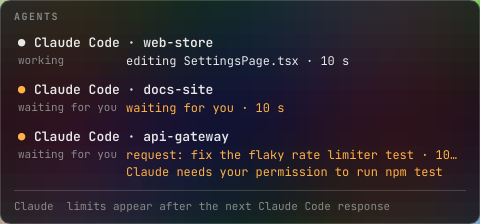

# Agents Roster

[](https://github.com/AbnerMSaconi/agents-roster/actions/workflows/ci.yml)


A floating desktop panel and system-tray icon that shows, live, the AI coding agents running on your
machine: what each one is doing, what comes next, context usage, rate limits, and desktop notifications.

[](https://slint.dev)

<p align="center">
  
</p>

<sub>Screenshot with example agents, taken in an isolated environment (no real sessions are shown).</sub>

## Features

- **Live process tracking** — only agents that are actually running appear; closed or crashed sessions
  disappear immediately (while still firing a completion or error notification). Suspended agents are ignored.
- **Supported agents** — Claude Code, agy (Antigravity CLI), Codex, nested subagents, and any other CLI added
  as a custom service.
- **Details per agent** — state, current tool, next step, milestones, git commits, context %, 5-hour and
  7-day limits, quota exhaustion.
- **Desktop notifications** — started, finished, needs input, error/quota, context thresholds and reminders,
  each routable to the OS or kept widget-only.
- **Control Panel** — theme presets, transparency, background blur, per-agent colors, service management.
- **Lightweight** — software renderer, about 20 MB of RAM and under 1 % of one CPU core.
- **Private** — everything runs locally; nothing is sent over the network.

## Quick start

```sh
# From a release tarball (see the Releases page)
tar xzf agents-roster-0.3.0-linux-x86_64.tar.gz && cd agents-roster-0.3.0-linux-x86_64
./install.sh

# Or from source
git clone https://github.com/AbnerMSaconi/agents-roster.git && cd agents-roster
./packaging/install.sh

agents-roster            # start the panel
agents-roster --version  # 0.3.0
```

Then connect Claude Code through its hooks: see [docs/INSTALL.md](docs/INSTALL.md).

## Documentation

| Document | Contents |
|---|---|
| [docs/INSTALL.md](docs/INSTALL.md) | Requirements, installing, Claude Code hooks, updating, uninstalling |
| [docs/USAGE.md](docs/USAGE.md) | The panel, Control Panel, CLI, environment variables, troubleshooting |
| [docs/COMPATIBILITY.md](docs/COMPATIBILITY.md) | Tested and expected systems, X11 vs Wayland, supported agents |
| [docs/ARCHITECTURE.md](docs/ARCHITECTURE.md) | Workspace crates, traits and contracts |
| [docs/PROVENANCE.md](docs/PROVENANCE.md) | Authorship marks and how to verify official releases |
| [docs/RELEASING.md](docs/RELEASING.md) | How a release is cut and signed |
| [SECURITY.md](SECURITY.md) | What the app reads, trust limits, reporting vulnerabilities |
| [CONTRIBUTING.md](CONTRIBUTING.md) | Building, testing other desktops, known gaps |
| [CHANGELOG.md](CHANGELOG.md) | Release notes |

## Compatibility at a glance

Linux with an X11 or Wayland session. Fully tested on KDE Plasma 6 (X11); Wayland starts and runs but is
new, and other distributions and desktops are expected to work but untested. Details and limits in
[docs/COMPATIBILITY.md](docs/COMPATIBILITY.md).

## Security and privacy

No network code and no telemetry. The app reads local data of the agents it tracks (process list and
their session files) to show their state, and writes only its own settings and a memory-backed
exchange directory. The project has **not** been independently audited. What it reads, the hook
privilege note and how to verify official binaries are in [SECURITY.md](SECURITY.md) and
[docs/PROVENANCE.md](docs/PROVENANCE.md).

## Repository layout

```
crates/      Rust workspace (core, sources, notify, ui, binary)
docs/        User and architecture documentation
packaging/   Desktop entries and install/uninstall scripts
scripts/     Release tooling (package, build, sign and verify scripts)
.github/     Issue template and CI/release workflows
```

## License

GNU Affero General Public License v3.0 — see [LICENSE](LICENSE) and [NOTICE](NOTICE).

- You may use, study, modify and share this software.
- Any copy or derivative you distribute (or offer as a network service) must stay under the AGPL-3.0 with its
  complete source code available. It cannot be turned into closed-source software.
- You must keep the copyright notice and the [NOTICE](NOTICE) attribution to the author and mark your changes.

Third-party notices are in [THIRD_PARTY.md](THIRD_PARTY.md).
